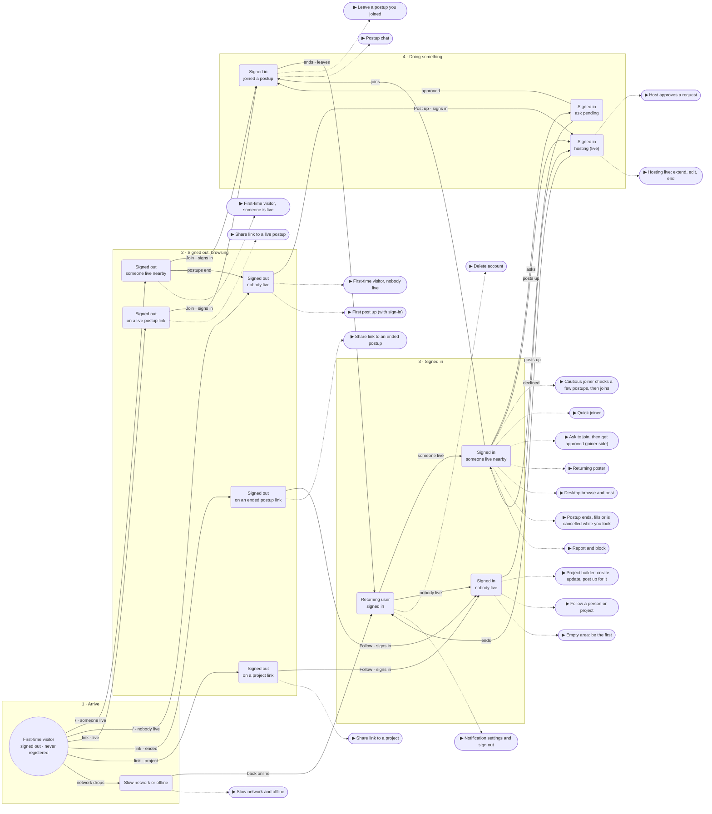

# PostUp flow map
Flow map (Martin, Oct 25 2026 [M1025]): a state machine from a first-time visitor (signed out, never registered) to the starting point of every critical flow. User states are grouped into four boxes, left to right: Arrive, Signed out browsing, Signed in, Doing something. Arrows are events or conditions (dashed = going back). Each flow’s badge sits inside the state where it starts (green = MVP must, grey = nice) and opens the flow player. All 23 flows are reachable from the root.

Page: /mockups/flows/map.html (grouped boxes, hand-placed) · grid: /mockups/flows/grid.html

## Groups
- **1 · Arrive**: First-time visitor · signed out · never registered, Slow network or offline [M1025]
- **2 · Signed out, browsing**: Signed out · on a live postup link, Signed out · someone live nearby, Signed out · nobody live, Signed out · on an ended postup link, Signed out · on a project link [M1025]
- **3 · Signed in**: Signed in · someone live nearby, Returning user · signed in, Signed in · nobody live [M1025]
- **4 · Doing something**: Signed in · ask pending, Signed in · joined a postup, Signed in · hosting (live) [M1025]

## Where each flow starts
- `first-visit-live` (MVP must): from state "Signed out · someone live nearby" [M1025]
- `first-visit-none` (MVP must): from state "Signed out · nobody live" [M1025]
- `first-post` (MVP must): from state "Signed out · nobody live" [M1025]
- `invite-live` (MVP must): from state "Signed out · on a live postup link" [M1025]
- `invite-ended` (MVP must): from state "Signed out · on an ended postup link" [M1025]
- `invite-project` (MVP must): from state "Signed out · on a project link" [M1025]
- `loading-offline` (MVP must): from state "Slow network or offline" [M1025]
- `cautious-joiner` (MVP must): from state "Signed in · someone live nearby" [M1025]
- `quick-joiner` (MVP must): from state "Signed in · someone live nearby" [M1025]
- `ask-join` (MVP must): from state "Signed in · someone live nearby" [M1025]
- `returning-post` (MVP must): from state "Signed in · someone live nearby" [M1025]
- `desktop-browse` (nice): from state "Signed in · someone live nearby" when on a laptop [M1025]
- `postup-states` (MVP must): from state "Signed in · someone live nearby" when postup fills or ends [M1025]
- `safety` (MVP must): from state "Signed in · someone live nearby" when someone feels off [M1025]
- `host-approve` (MVP must): from state "Signed in · hosting (live)" when gets a request [M1025]
- `hosting` (MVP must): from state "Signed in · hosting (live)" [M1025]
- `leave` (MVP must): from state "Signed in · joined a postup" when plans change [M1025]
- `chat` (MVP must): from state "Signed in · joined a postup" [M1025]
- `project-builder` (MVP must): from state "Signed in · nobody live" [M1025]
- `following` (MVP must): from state "Signed in · nobody live" [M1025]
- `empty-area` (MVP must): from state "Signed in · nobody live" when area has no postups [M1025]
- `delete-account` (MVP must): from state "Returning user · signed in" [M1025]
- `settings-notify` (nice): from state "Returning user · signed in" [M1025]
